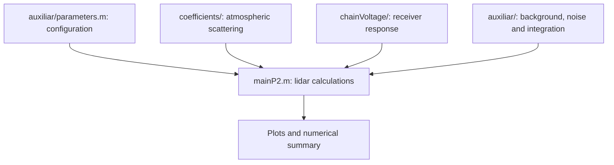

# Lidar characterisation in MATLAB: elastic and Raman channels

A MATLAB model for comparing elastic and Raman lidar receiver performance under different atmospheric, optical and operating conditions. It calculates returned power, signal-to-noise ratio (SNR), noise-equivalent power (NEP) and pulse integration time for an educational lidar characterisation study.

The model uses a 532 nm elastic channel with an avalanche photodiode and a 607.4 nm Raman channel with a photomultiplier. The default range is 0.2 to 15 km.

## What you can explore

- Laser pulse energy and repetition rate.
- Telescope aperture, receiver gain and filter bandwidth.
- Atmospheric visibility, aerosol scattering and boundary-layer height.
- Daytime and night-time background light.
- Detector noise and the observation time needed to reach a target SNR.

## Run the model

Clone or download the repository, then open its root folder in MATLAB. Add the helper folders to the path and run:

```matlab
addpath('auxiliar', 'chainVoltage', 'coefficients');
mainP2
```

Choose a configuration by changing `code` near the top of [mainP2.m](mainP2.m). The available presets are `0`, `1`, `2`, `3`, `5` and `6`; the default is `2`. Edit [auxiliar/parameters.m](auxiliar/parameters.m) to adjust their values.

The script plots power, SNR, noise contributions and observation time, and prints a parameter and detector summary in the Command Window.

## Code overview



The Raman SNR calculation follows the Hamamatsu formulas referenced in the original study. The supporting [Hamamatsu application note](pdf/HAMAMATSU_AN1998.pdf) is included.

## Study notes

Some filenames retain the original spelling `Ramen`. The final range-versus-observation-time calculation is unfinished: [question9.m](auxiliar/question9.m) calculates `SNRN` without assigning it to its `SNR` output. That plot needs further work before its results can be used.

## Licence

[Creative Commons Attribution-NonCommercial-ShareAlike 3.0 Unported](LICENSE.txt). Shared for educational and showcase purposes.
